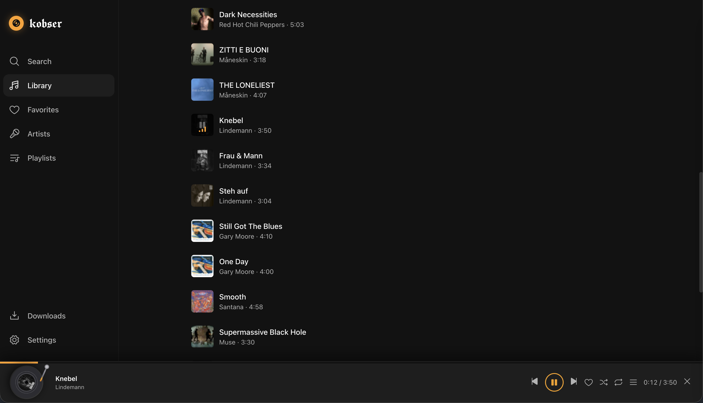
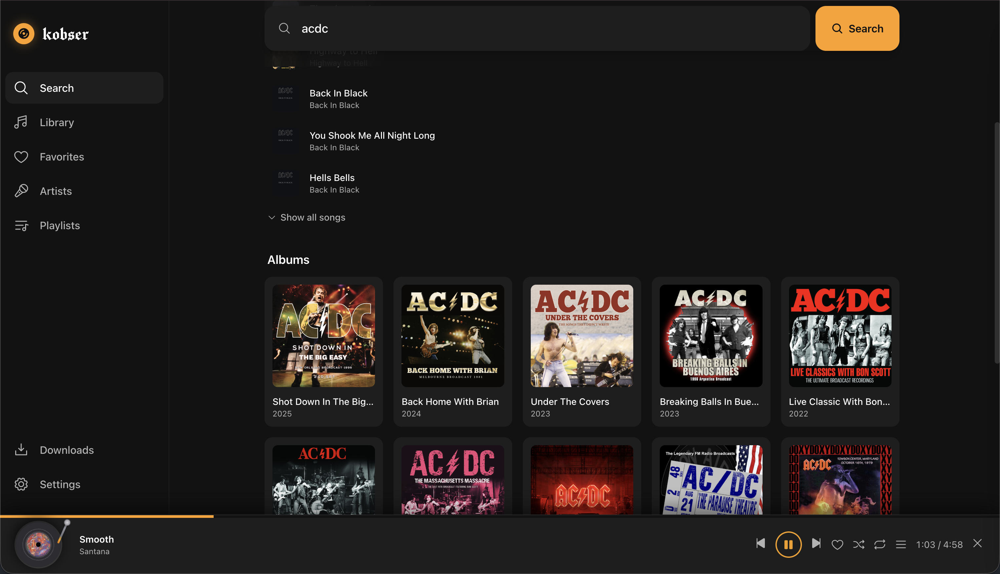
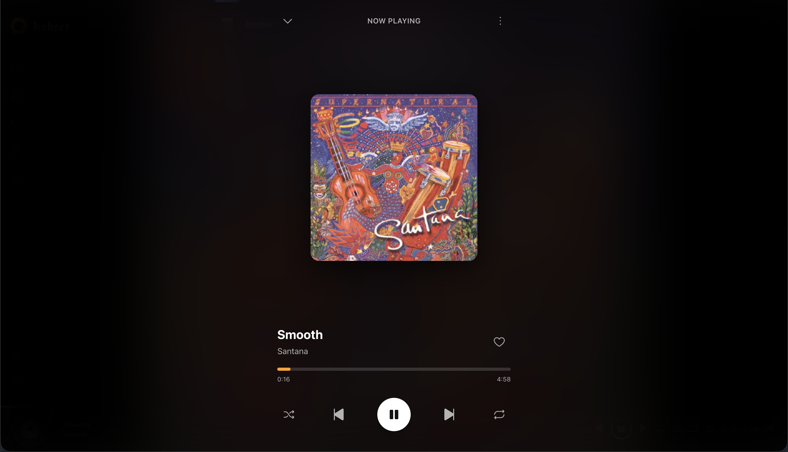
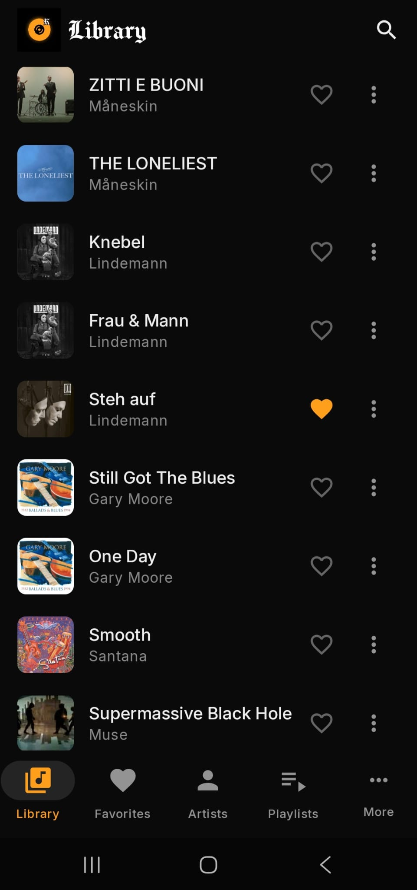
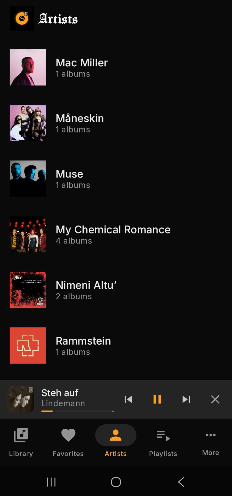
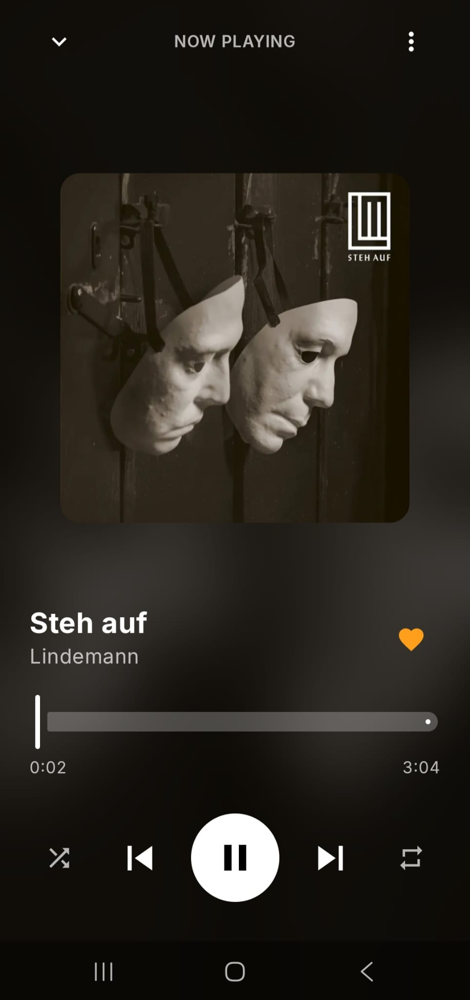
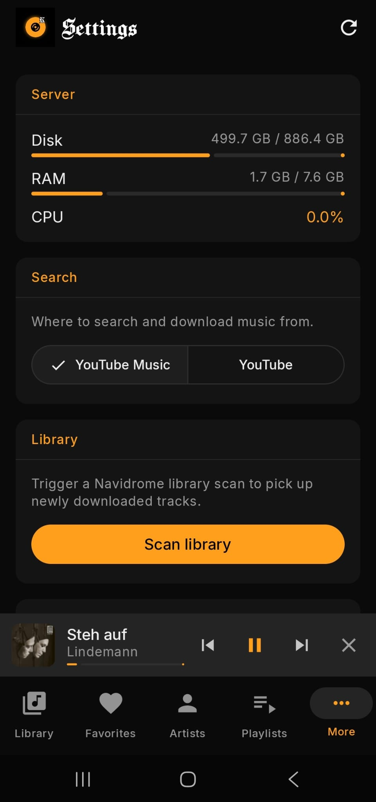

# kobser

kobser is a self-hosted music app for a [Navidrome](https://www.navidrome.org/) server. It has a web app and an Android app with Android Auto support, and besides playing your library it can search YouTube and YouTube Music and save songs into the library.

The backend is a FastAPI service that runs next to Navidrome and uses Navidrome's accounts and Subsonic API. The web app is written in Svelte, and the Android app in Kotlin with Jetpack Compose.

---

## Screenshots

### Web app

<table>
  <tr>
    <td></td>
    <td></td>
    <td></td>
  </tr>
</table>

### Android app

<table>
  <tr>
    <td></td>
    <td></td>
    <td></td>
    <td></td>
  </tr>
</table>

---

## Features

### Web app and Android app

Finding and adding music:
- Search YouTube Music or YouTube for songs and artists (the source is chosen in the settings), and open an artist's top songs, full song list and albums.
- Preview any result before you save it.
- Save a single song or a whole album to the library. You can edit the artist, title and album before saving, kobser adds the cover art, and it warns you if the song is already in the library.
- Follow downloads in a list where you can cancel, retry or remove them.
- Import a public Spotify playlist, which adds its songs to the library and creates a Navidrome playlist with them.

Library and playback:
- Browse songs, artists and albums, filter by title or artist, and sort by date added, title, artist or length.
- Mark songs as favorites, which are Navidrome's starred songs.
- Create, rename and delete playlists, and add or remove songs.
- Delete songs from the library.
- Shuffle, repeat, seek, and a queue you can reorder and add songs to.
- Plays are reported to Navidrome, so play counts and Navidrome's Last.fm or ListenBrainz scrobbling work.

Server and accounts:
- The settings show the server's disk, memory and CPU use and can start a library scan.
- Several Navidrome users can share one server, and each user's downloads go to the library Navidrome assigns to them.

### Android app only

- Keep albums, playlists or single songs on the phone and play them without a connection from the Offline music screen.
- Streamed songs are cached on the phone, 1 GB by default and adjustable in the settings, so replaying them doesn't download them again.
- A sleep timer that stops playback after 15 to 60 minutes or at the end of the current song.
- In the queue, swipe a song away to remove it or clear everything after the current song. With shuffle on, the queue shows the shuffled order.
- Your last 20 YouTube and YouTube Music searches.
- A message when a download finishes or fails, from any screen.
- Playback controls in the notification, on the lock screen and over Bluetooth.

### Android Auto

- Browse Recently played, Recently added, Favorites, Playlists, Albums, Artists and Songs. Libraries with more than 150 songs are split into A–Z folders.
- Search the library and YouTube Music or YouTube by voice or text, where YouTube results play as previews.
- Shuffle and repeat buttons.
- Resume the last queue from the car or a Bluetooth device.
- A settings section in the phone app that lists the setup steps and logs recent connections from Android Auto.

---

## Requirements

- [Docker](https://docs.docker.com/get-docker/) and [Docker Compose](https://docs.docker.com/compose/)
- Navidrome 0.59 or newer if you use your own Navidrome. Older versions work but rescan the whole library after each download or delete, so changes take longer to appear.
- Android 8.0 or newer for the Android app

The server image is published on [ghcr.io](https://github.com/kobsermusic/kobser/pkgs/container/kobser), so you don't need to build anything.

---

## Installation

### Navidrome and kobser together

Use this setup if you don't run Navidrome yet.

```bash
mkdir kobser && cd kobser
curl -O https://raw.githubusercontent.com/kobsermusic/kobser/master/docker-compose.yml
curl -O https://raw.githubusercontent.com/kobsermusic/kobser/master/.env.example
mv .env.example .env
# Edit .env and set MUSIC_DIR to the folder for your music.
docker compose --profile full up -d
```

Then open Navidrome at `http://localhost:4533` and create the admin account, and log in to kobser at `http://localhost:8000` with the same username and password. Further accounts and their libraries are also managed in Navidrome.

### kobser with an existing Navidrome

Download the same two files, then set `NAVIDROME_URL` in `.env` to the address of your Navidrome and `MUSIC_DIR` to the music folder Navidrome uses. Start kobser without the `full` profile, so that only the kobser container runs:

```bash
docker compose up -d
```

### Updating

```bash
docker compose pull
docker compose up -d        # add --profile full if you use the bundled Navidrome
```

---

## Configuration

All settings are in `.env`, and `docker compose up -d` applies a change.

| Variable | Default | Description |
|---|---|---|
| `MUSIC_DIR` | `./data/music` | Folder on the host where music files are stored |
| `KOBSER_PORT` | `8000` | Port of the kobser web app and API |
| `NAVIDROME_PORT` | `4533` | Port of the bundled Navidrome |
| `NAVIDROME_URL` | `http://navidrome:4533` | Address of an existing Navidrome |
| `YTDLP_COOKIES_FILE` | _(unset)_ | Path to a YouTube `cookies.txt` |

Some videos, for example age-restricted ones, can only be downloaded with a signed-in YouTube account. For those, export your browser's YouTube cookies as a Netscape-format `cookies.txt`, put the file in `secrets/` and set `YTDLP_COOKIES_FILE=./secrets/cookies.txt`.

---

## Android app

Download the APK from the [Releases](https://github.com/kobsermusic/kobser/releases) page, allow installs from unknown sources and open the file. On first start, enter the server address (for example `http://192.168.1.50:8000`) and log in with your Navidrome account. New versions install over the old one.

Because the app isn't installed from Google Play, Android Auto only lists it when "Unknown sources" is turned on in Android Auto's developer settings. If the app still doesn't appear in the car, set its battery usage to Unrestricted, and check the connection log in the app's Android Auto settings to see whether Android Auto contacted the app at all.

---

## Data and file ownership

| Path | Contents |
|---|---|
| `./data/music/` | Music files |
| `./data/navidrome/` | Navidrome database and config |
| `./data/kobser/` | kobser database (sessions and download history) |

The kobser container runs as a non-root user with uid and gid 1000. At startup it gives that user ownership of `data/kobser` and `secrets`, and of the music folder itself but not of the files inside it, because a library can be large, and new music files belong to uid 1000. If another program wrote files to the music folder as root, change their owner once so that kobser can delete them:

```bash
sudo chown -R 1000:1000 /path/to/your/music
```

---

## Security

If kobser is reachable from the internet, the connection has to be secured with HTTPS. Caddy's [reverse proxy guide](https://caddyserver.com/docs/quick-starts/reverse-proxy) shows one way to set this up. [SECURITY.md](SECURITY.md) explains how to report a vulnerability.

---

## Legal

kobser uses [yt-dlp](https://github.com/yt-dlp/yt-dlp) to download audio from YouTube. Downloading copyrighted material without permission can violate YouTube's Terms of Service and copyright law, so use kobser only for content you have the right to download. You are responsible for how you use it.

---

## Contributing and license

[CONTRIBUTING.md](CONTRIBUTING.md) explains how to build and test the project. kobser is free software under the [GNU General Public License v3](LICENSE).
